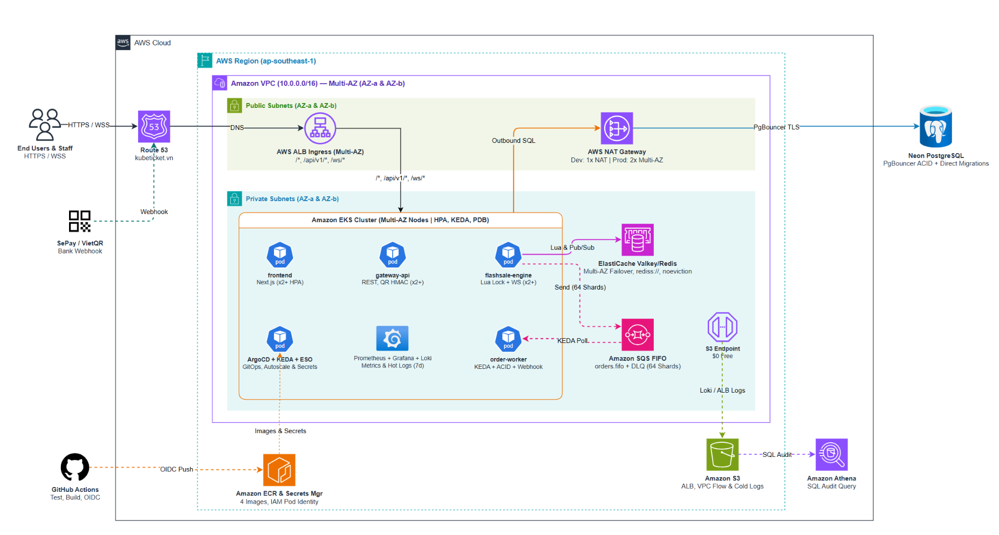

# KubeTicket

Cloud-native **Flash Sale Event Ticketing** system built with **Golang microservices**, **Next.js (TypeScript)**, **Redis**, **PostgreSQL (Neon / PgBouncer)**, **Amazon SQS FIFO**, and **Kubernetes GitOps (ArgoCD + Prometheus/Grafana)**.

## Core Architecture Guarantees

1. **Zero Overselling (Defense-in-Depth):**
   - Fast-path atomic seat locking via **Redis Lua Scripts** (`HELD` 300s → `CHECKOUT` 900s) and `ZSET` expiration sweeper.
   - Final ACID backstop in PostgreSQL via a partial unique index on active tickets (`PENDING`, `PAID`, `CHECKED_IN`).
2. **Traffic Spike Protection:**
   - **Virtual Waiting Room** (`ZADD NX` per user, adaptive admission rate, bound admission token) uses a distributed Redis mutex (`SETNX` + Lua release) and shared per-second admission budget (`AdmitBatch`) so multi-Pod HPA replicas cannot over-admit.
   - Asynchronous order ingestion via **Amazon SQS FIFO** (sharded across 64 deterministic `MessageGroupId`s per event via FNV-32a, or Redis Streams locally) processed concurrently by **KEDA**-autoscaled `order-worker` Pods.
3. **Real-Time Seat Map & Resilient UX:**
   - **WebSocket Hub** fans out batched delta updates over **Redis Pub/Sub** with snapshot `seq` recovery and server-synced countdown timers.
4. **Secure E-Tickets & Gate Check-In:**
   - `HMAC-SHA256` signed QR payloads and atomic `ON CONFLICT DO NOTHING` gate check-in to prevent duplicate scans.

## AWS EKS Architecture



## Monorepo Layout

```text
kubeticket/
├── db/             # PostgreSQL migrations and seed data
├── services/       # Go workspace: pkg, gateway-api, flashsale-engine, order-worker
├── frontend/       # Next.js (standalone) + TailwindCSS + Zustand web app
├── deploy/         # Helm charts, ArgoCD manifests, Prometheus/Grafana monitoring
├── infra/          # Terraform IaC (modular blueprint)
└── tests/          # End-to-end concurrency & booking flow tests
```

## Quickstart (Local Development)

1. Copy environment variables:
   ```bash
   cp .env.example .env
   ```
2. Start local stack (choose the profile you need):
   ```bash
   make up       # DB, Redis, 3 Go services, Nginx edge-gateway
   make up-obs   # Backend stack + Prometheus & Grafana
   make up-full  # Full stack (Backend + Next.js Frontend + Prometheus & Grafana)
   ```
3. Run database migrations and seed data:
   ```bash
   make migrate-up
   make seed
   ```
4. Run tests, race detector, and linters:
   ```bash
   make test
   make test-race
   make lint
   make help
   ```

## Service Topology & Routing

| Component | Port | Health / Readiness | Metrics | Routed Paths |
| --- | --- | --- | --- | --- |
| `gateway-api` | `8080` | `/healthz`, `/readyz` | `/metrics` | `/api` (default REST API) |
| `flashsale-engine` | `8081` | `/healthz`, `/readyz` | `/metrics` | `/ws`, `/api/v1/waiting-room`, `/api/v1/holds`, `/api/v1/checkout` |
| `order-worker` | `8082` | `/healthz`, `/readyz` | `/metrics` | `/api/v1/webhooks`, `/api/v1/payments`, SQS FIFO consumer |
| `frontend` | `3000` | `/api/runtime-config` | — | `/` (Next.js standalone UI + runtime proxy) |

## Kubernetes Deployment & Helm Chart Design (`deploy/`)

The Helm chart under `deploy/charts/kubeticket/` translates the local `docker-compose.yml` and `docker/nginx/default.conf` topology into environment-aware Kubernetes manifests.

### Configuration Strategy (3-Tier Separation)

Runtime configuration from `services/pkg/config/config.go` and Next.js runtime routes (`frontend/src/app/api/*`) is split into three tiers:

1. **Shared Non-Sensitive Config (`templates/configmap.yaml`, implemented):**
   - `<fullname>-config`: Go service settings (`APP_ENV`, `LOG_LEVEL`, `DB_MAX_CONNS`, `DB_MIN_CONNS`, `DB_SIMPLE_PROTOCOL`, `REDIS_MODE`, `SEAT_HOLD_TTL_SECONDS`, `CHECKOUT_HOLD_TTL_SECONDS`, `QUEUE_ADMISSION_RATE`, `JWT_EXPIRES_IN`, `COOKIE_SECURE`, `AWS_REGION`, `SQS_ORDER_QUEUE_URL`, `PAYMENT_PROVIDER`, `PAYMENT_WEBHOOK_TOLERANCE_SECONDS`, `PROMETHEUS_METRICS_PATH`, `CORS_ALLOWED_ORIGINS`).
   - `<fullname>-frontend-config`: Next.js runtime variables (`NEXT_PUBLIC_API_URL`, `NEXT_PUBLIC_WS_URL`, `BACKEND_INTERNAL_URL`, defaulting to `http://<fullname>-gateway-api:8080` when empty).
2. **Sensitive Credentials (`templates/secret.yaml`, `templates/externalsecret.yaml` & `templates/serviceaccount.yaml`, implemented):**
   - Managed keys (`DATABASE_URL`, `NEON_DATABASE_DIRECT_URL`, `REDIS_URL`, `JWT_SECRET`, `TICKET_QR_HMAC_SECRET`, `TURNSTILE_SECRET_KEY`, `STRIPE_SECRET_KEY`, `STRIPE_WEBHOOK_SECRET`) resolve to a single target Secret (`kubeticket.secretName`):
     - **Local (`externalSecrets.enabled=false`):** Helm renders an `Opaque` Kubernetes `Secret` from `values-local.yaml`.
     - **EKS (`externalSecrets.enabled=true`):** Helm renders an `ExternalSecret` (`external-secrets.io/v1beta1`) syncing from AWS Secrets Manager (`kubeticket/<env>/secrets`) via `ClusterSecretStore`, paired with IRSA annotations on `ServiceAccount`.
     - **Pre-created secret (`secrets.existingSecret`):** skips both templates and binds directly to an existing cluster Secret.
3. **Per-Workload Identity (`templates/deployment.yaml`, implemented):**
   - Multi-service loop (`services` map) generates Deployments and ClusterIP Services (`templates/service.yaml`) for all 4 workloads, injecting `PORT`, `APP_NAME`, security contexts (`runAsNonRoot`), probes, and `checksum/config` / `checksum/secret` rollout annotations.
   - `spec.replicas` is omitted automatically whenever `autoscaling.enabled` or KEDA (`keda.enabled` on `order-worker`) controls replica count, preventing GitOps drift.
   - `templates/ingress.yaml` translates `docker/nginx/default.conf` into ordered explicit `Prefix` routes compatible with both NGINX Ingress (local) and AWS ALB (EKS).
   - `templates/migration-job.yaml` runs a `pre-install,pre-upgrade` Helm Hook Job using `NEON_DATABASE_DIRECT_URL` (falling back to `DATABASE_URL`).
4. **Autoscaling, Resilience & Metrics (`templates/hpa.yaml`, `templates/scaledobject.yaml`, `templates/pdb.yaml`, `templates/servicemonitor.yaml`, implemented):**
   - `HorizontalPodAutoscaler` (`autoscaling/v2`) scales `gateway-api`, `flashsale-engine`, and `frontend` with fast flash-sale scale-up stabilization and conservative scale-down.
   - KEDA `ScaledObject` (`keda.sh/v1alpha1`) scales `order-worker` by AWS SQS FIFO `queueLength` using Pod IRSA (`identityOwner: pod`), while suppressing any overlapping manual HPA on `order-worker`.
   - `PodDisruptionBudget` (`policy/v1`) preserves minimum availability during node drains (`minAvailable: 2` for `gateway-api` and `flashsale-engine` in prod; disabled locally).
   - `ServiceMonitor` (`monitoring.coreos.com/v1`) scrapes `/metrics` across enabled Go services (`gateway-api`, `flashsale-engine`, `order-worker`) via `app.kubernetes.io/component`.

### Environment Values Hierarchy

| File | Purpose | Key Overrides |
| --- | --- | --- |
| `values.yaml` | Production-safe chart defaults | `APP_ENV=production`, `COOKIE_SECURE=true`, `DB_SIMPLE_PROTOCOL=true`, `externalSecrets.enabled=true`, `ingress.className=alb`, HPA/KEDA/PDB/ServiceMonitor enabled |
| `values-local.yaml` | Local `kind` / `k3d` testing *(excluded by `.helmignore` on package)* | `APP_ENV=development`, `LOG_LEVEL=debug`, `DB_SIMPLE_PROTOCOL=false`, `COOKIE_SECURE=false`, `externalSecrets.enabled=false`, `ingress.className=nginx`, `replicaCount=1`, HPA/KEDA/PDB/ServiceMonitor disabled |
| `values-dev.yaml` | EKS staging / dev environment | `APP_ENV=staging`, `wss://dev.kubeticket.example.com`, IRSA role + `kubeticket/dev/secrets`, HPA max `4–5`, KEDA `1–6` |
| `values-prod.yaml` | EKS production environment | `APP_ENV=production`, `DB_MAX_CONNS=20`, `DB_MIN_CONNS=5`, `QUEUE_ADMISSION_RATE=100`, IRSA role + `kubeticket/prod/secrets`, HPA up to `15–25`, KEDA `2–30`, `pdb.minAvailable=2` |

### GitOps Delivery (`deploy/argocd/`)

- [`deploy/argocd/application-local.yaml`](deploy/argocd/application-local.yaml): ArgoCD `Application` deploying `deploy/charts/kubeticket` with `values-local.yaml` from GitLab into `kubeticket-local` (`automated` prune + self-heal).
- [`deploy/argocd/applicationset-eks.yaml`](deploy/argocd/applicationset-eks.yaml): ArgoCD `ApplicationSet` (`goTemplate` list generator) targeting `kubeticket-dev` (auto-sync) and `kubeticket-prod` (manual promotion sync), ignoring `/spec/replicas` drift for HPA/KEDA.

### Observability & Monitoring (`deploy/monitoring/`)

- [`deploy/monitoring/prometheus-local.yml`](deploy/monitoring/prometheus-local.yml): local Docker Compose scrape targets for `gateway-api:8080`, `flashsale-engine:8081`, and `order-worker:8082`.
- [`deploy/monitoring/prometheus-rules.yaml`](deploy/monitoring/prometheus-rules.yaml): `PrometheusRule` alerts for 5xx error ratio, p95 latency, SQS worker retries/permanent failures, seat-lock contention, and Pod health (`CrashLoopBackOff`, `NotReady`) aligned with `services/pkg/observability/metrics.go`.
- [`deploy/monitoring/alertmanager.yaml`](deploy/monitoring/alertmanager.yaml): Alertmanager routing and inhibition rules sending alerts to Telegram via a mounted secret token file.
- [`deploy/monitoring/grafana-dashboard-kubeticket.json`](deploy/monitoring/grafana-dashboard-kubeticket.json): importable Grafana dashboard covering RED HTTP metrics, active WebSocket connections, seat lock conflicts, queue throughput (`ok`/`retry`/`permanent_error`), goroutines, and RSS memory.

### Helm & GitOps Implementation Progress

- **Implemented (`deploy/` complete):**
  - `deploy/charts/kubeticket/`: `Chart.yaml`, `.helmignore`, `templates/_helpers.tpl`, `templates/configmap.yaml`, `templates/serviceaccount.yaml`, `templates/secret.yaml`, `templates/externalsecret.yaml`, `templates/deployment.yaml`, `templates/service.yaml`, `templates/ingress.yaml`, `templates/migration-job.yaml`, `templates/hpa.yaml`, `templates/scaledobject.yaml`, `templates/pdb.yaml`, `templates/servicemonitor.yaml`, `values.yaml`, `values-local.yaml`, `values-dev.yaml`, `values-prod.yaml`.
  - `deploy/argocd/`: `application-local.yaml`, `applicationset-eks.yaml`.
  - `deploy/monitoring/`: `prometheus-local.yml`, `prometheus-rules.yaml`, `alertmanager.yaml`, `grafana-dashboard-kubeticket.json`.

### Validate, Deploy & Observe (`deploy/`)

1. **Validate & render Helm templates locally:**
   ```bash
   helm lint deploy/charts/kubeticket -f deploy/charts/kubeticket/values-local.yaml
   helm template kubeticket deploy/charts/kubeticket -f deploy/charts/kubeticket/values-local.yaml
   helm template kubeticket deploy/charts/kubeticket -f deploy/charts/kubeticket/values-prod.yaml
   ```

2. **Deploy directly with Helm (local `kind` / `k3d`):**
   ```bash
   helm upgrade --install kubeticket deploy/charts/kubeticket \
     -n kubeticket-local --create-namespace \
     -f deploy/charts/kubeticket/values-local.yaml
   ```

3. **Deploy via ArgoCD GitOps:**
   ```bash
   # Local single-cluster automated sync
   kubectl apply -f deploy/argocd/application-local.yaml

   # AWS EKS multi-environment ApplicationSet (dev auto-sync + prod manual promotion)
   kubectl apply -f deploy/argocd/applicationset-eks.yaml
   ```

4. **Enable Monitoring & Alerting:**
   ```bash
   # Apply PrometheusRule alerts on cluster (requires kube-prometheus-stack)
   kubectl apply -n monitoring -f deploy/monitoring/prometheus-rules.yaml
   ```
   - Mount your Telegram bot token into Alertmanager at `/etc/alertmanager/secrets/telegram-bot-token` and set `chat_id` in [`deploy/monitoring/alertmanager.yaml`](deploy/monitoring/alertmanager.yaml).
   - Import [`deploy/monitoring/grafana-dashboard-kubeticket.json`](deploy/monitoring/grafana-dashboard-kubeticket.json) in Grafana (**Dashboards → Import**) to monitor HTTP RED metrics, WebSocket connections, seat lock conflicts, and worker queue throughput.
