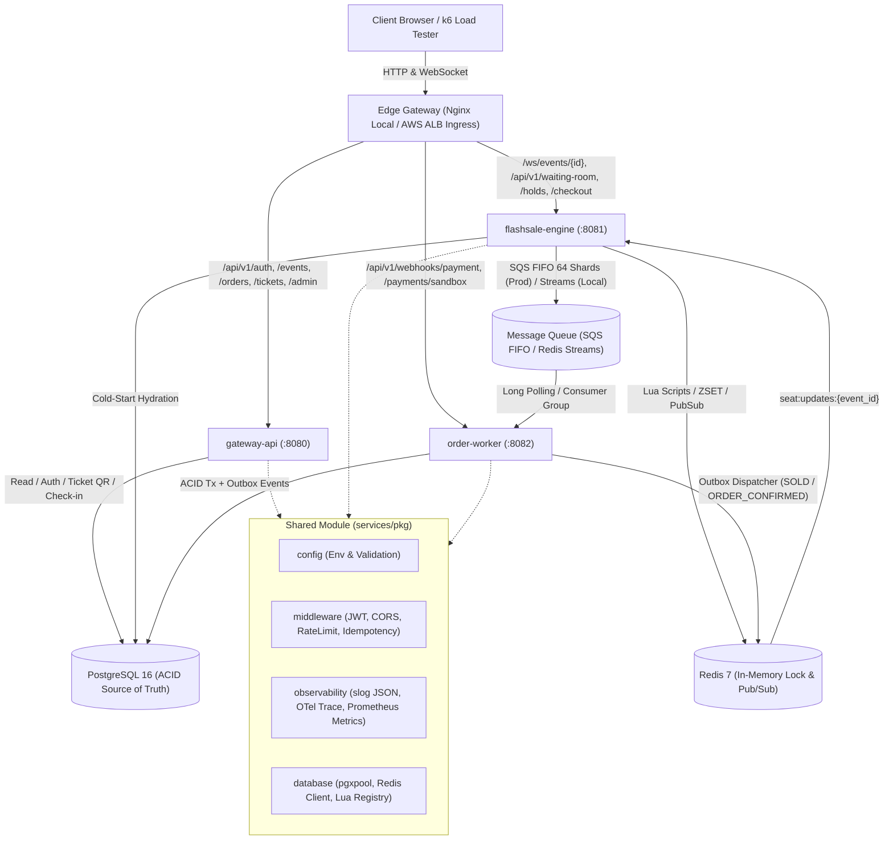
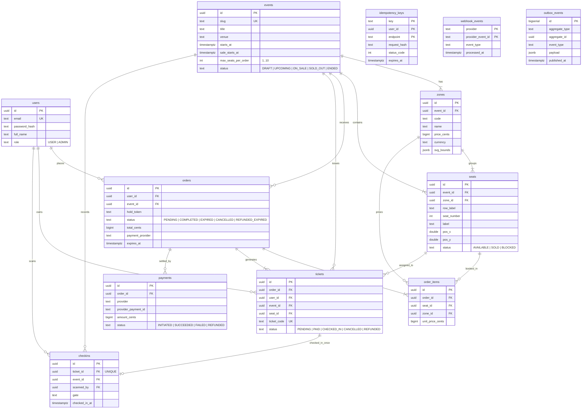
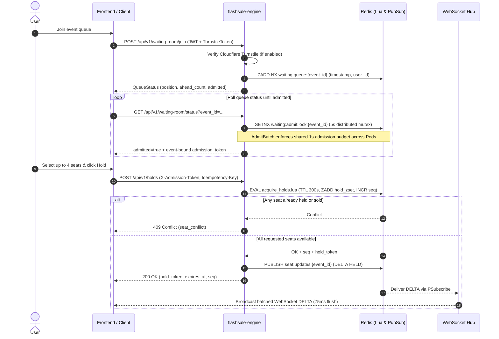
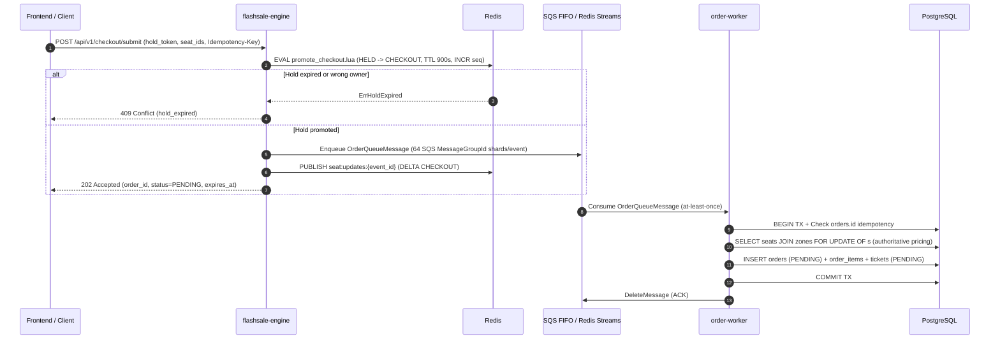
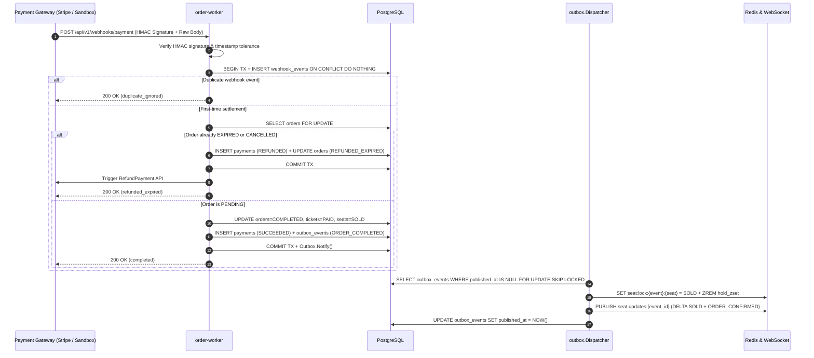
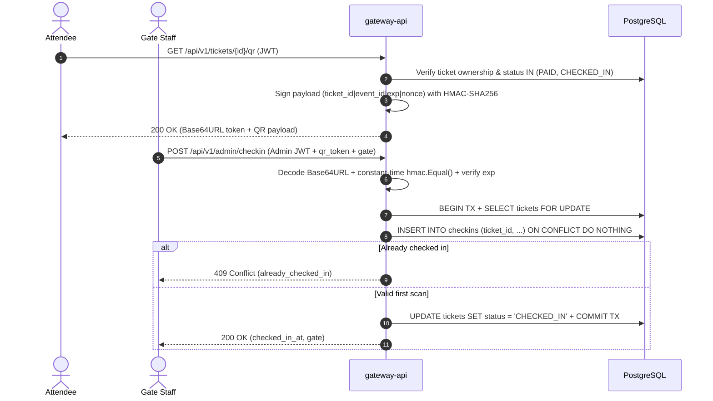
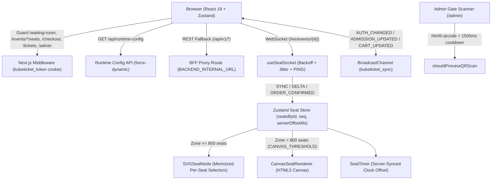
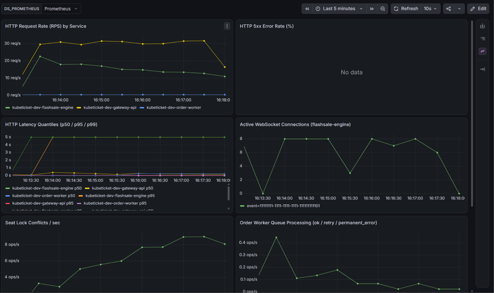

# KubeTicket

Cloud-native **Flash Sale Event Ticketing** system built with **Golang microservices**, **Next.js (TypeScript)**, **Redis**, **PostgreSQL (Neon / PgBouncer)**, **Amazon SQS FIFO**, and **Kubernetes GitOps (ArgoCD + Prometheus/Grafana)**.

## Documentation Sections

- [Core Architecture & EKS Blueprint](#core-architecture-guarantees)
- [Quickstart & Service Topology](#quickstart-local-development)
- [Backend Architecture, ERD & Sequence Diagrams](#backend-architecture--data-design-services-db)
- [Frontend Architecture & Real-Time UX](#frontend-architecture--real-time-ux-frontend)
- [Kubernetes, Helm, GitOps & Observability](#kubernetes-deployment--helm-chart-design-deploy)
- [Infrastructure as Code (`infra/`)](#infrastructure-as-code-infra)
- [Load Testing (`k6`)](#load-testing-testsk6flashsale-loadjs)

## Core Architecture Guarantees

1. **Zero Overselling (Defense-in-Depth):**
   - Fast-path atomic seat locking via **Redis Lua Scripts** (`HELD` 300s → `CHECKOUT` 900s) and `ZSET` expiration sweeper.
   - Final ACID backstop in PostgreSQL via a partial unique index on active tickets (`PENDING`, `PAID`, `CHECKED_IN`).
2. **Traffic Spike Protection:**
   - **Virtual Waiting Room** (`ZADD NX` per user, adaptive admission rate, bound admission token) uses a distributed Redis mutex (`SETNX` + Lua release) and shared per-second admission budget (`AdmitBatch`) so multi-Pod HPA replicas cannot over-admit.
   - Asynchronous order ingestion via **Amazon SQS FIFO** (sharded across 64 deterministic `MessageGroupId`s per event via FNV-32a, or Redis Streams locally) processed concurrently by **KEDA**-autoscaled `order-worker` Pods.
3. **Real-Time Seat Map & Resilient UX:**
   - **WebSocket Hub** fans out batched delta updates over **Redis Pub/Sub** with snapshot `seq` recovery and server-synced countdown timers.
4. **Secure E-Tickets & Gate Check-In:**
   - `HMAC-SHA256` signed QR payloads and atomic `ON CONFLICT DO NOTHING` gate check-in to prevent duplicate scans.

## AWS EKS Architecture


## Monorepo Layout

```text
kubeticket/
├── db/             # PostgreSQL migrations and seed data
├── services/       # Go workspace: pkg, gateway-api, flashsale-engine, order-worker
├── frontend/       # Next.js (standalone) + TailwindCSS + Zustand web app
├── deploy/         # Helm charts, ArgoCD manifests, Prometheus/Grafana monitoring
├── infra/          # Terraform IaC (modular blueprint)
└── tests/          # End-to-end concurrency & booking flow tests
```

## Quickstart (Local Development)

1. Copy environment variables:
   ```bash
   cp .env.example .env
   ```
2. Start local stack (choose the profile you need):
   ```bash
   make up       # DB, Redis, 3 Go services, Nginx edge-gateway
   make up-obs   # Backend stack + Prometheus & Grafana
   make up-full  # Full stack (Backend + Next.js Frontend + Prometheus & Grafana)
   ```
3. Run database migrations and seed data:
   ```bash
   make migrate-up
   make seed
   ```
4. Run tests, race detector, and linters:
   ```bash
   make test
   make test-race
   make lint
   make help
   ```

## Service Topology & Routing

| Component | Port | Health / Readiness | Metrics | Routed Paths |
| --- | --- | --- | --- | --- |
| `gateway-api` | `8080` | `/healthz`, `/readyz` | `/metrics` | `/api` (default REST API) |
| `flashsale-engine` | `8081` | `/healthz`, `/readyz` | `/metrics` | `/ws`, `/api/v1/waiting-room`, `/api/v1/holds`, `/api/v1/checkout` |
| `order-worker` | `8082` | `/healthz`, `/readyz` | `/metrics` | `/api/v1/webhooks`, `/api/v1/payments`, SQS FIFO consumer |
| `frontend` | `3000` | `/api/runtime-config` | — | `/` (Next.js standalone UI + runtime proxy) |

## Backend Architecture & Data Design (`services/`, `db/`)

The backend lives in a Go workspace (`services/go.work`) consisting of three decoupled services (`gateway-api`, `flashsale-engine`, `order-worker`) sharing `services/pkg` (`config`, `database`, `middleware`, `models`, `observability`).

### Microservices Architecture



### Database Schema & ERD (`db/migrations/001_init.up.sql`)



Key ACID & indexing guarantees:
- **Active ticket lock (`ux_tickets_active_event_seat`):** partial unique index on `tickets (event_id, seat_id) WHERE status IN ('PENDING', 'PAID', 'CHECKED_IN')`, allowing canceled/refunded seats to be re-sold while strictly preventing double-booking.
- **Duplicate scan prevention (`checkins`):** `UNIQUE (ticket_id)` paired with `INSERT ... ON CONFLICT (ticket_id) DO NOTHING`.
- **Webhook & API deduplication:** composite PK `(provider, provider_event_id)` on `webhook_events` and `(user_id, endpoint, key)` on `idempotency_keys`.
- **Non-blocking outbox polling (`idx_outbox_unpublished`):** partial index `WHERE published_at IS NULL` queried via `FOR UPDATE SKIP LOCKED`.

### Core Sequence Diagrams

#### 1. Virtual Waiting Room & Atomic Seat Hold



#### 2. Async Checkout & ACID Order Persistence



#### 3. Payment Webhook Settlement, Late-Webhook Refund & Outbox Fan-out



#### 4. Signed QR E-Ticket & Atomic Gate Check-In



### Resilience Patterns & System Advantages

- **Cold-Start Redis Hydration (`HydrateFromPostgres`):** `flashsale-engine` blocks `/readyz` until all active `PENDING`, `PAID`, and `CHECKED_IN` seats are restored from PostgreSQL into Redis.
- **Distributed Expiry Sweeper & Order Reconciler:** `SweepExpiredHolds` acquires a short per-event Redis leader lock (`1500ms`) to release expired `HELD` seats via `expire_seat.lua`, while `ExpirePendingOrders` cancels unpaid `PENDING` orders after `CHECKOUT_HOLD_TTL_SECONDS`.
- **Two-Layer Rate Limiting & Idempotency:** Redis Lua fixed-window quotas protect auth (`30/min`), waiting-room join (`20/min`), holds (`40/min`), and checkout (`15/min`), paired with mandatory `Idempotency-Key` headers on mutating flash-sale endpoints.
- **Lightweight Distroless Containers & Full Observability:** All three Go binaries compile statically (`CGO_ENABLED=0`) onto `gcr.io/distroless/static-debian12:nonroot`, exposing structured JSON logs with OpenTelemetry `trace_id` and Prometheus `/metrics` (with `http.Hijacker` preserved for WebSocket upgrades).

## Frontend Architecture & Real-Time UX (`frontend/`)

The web client is a **Next.js 15 (App Router, `output: "standalone"`) + React 19 + TypeScript + TailwindCSS + Zustand 5** application designed with the *Stadium Turnstile* UI system and zero build-time environment lock-in.

### Frontend Component & Data Flow



### App Router Pages & Auth Protection

| Route | Protection | Key Functionality |
| --- | --- | --- |
| `/`, `/login`, `/register` | Public | Event catalog discovery, JWT login/register (`kubeticket_token` cookie) |
| `/waiting-room` | Middleware (`kubeticket_token`) | Queue join + polling until `admitted=true`, stores event-bound `admission_token` in `sessionStorage` |
| `/events/[id]/seats` | Middleware + Admission Token | 2-tier seat map, optimistic hold/release (`POST /holds`, `DELETE /holds/{id}`), live WebSocket updates |
| `/checkout`, `/checkout/result` | Middleware | Order submission (`POST /checkout/submit`), async order status polling & sandbox settlement |
| `/tickets` | Middleware | Signed `HMAC-SHA256` QR e-ticket display rendered client-side via `qrcode` |
| `/admin` | Middleware + `ADMIN` role | Gate QR scanner (`html5-qrcode`) with `shouldProcessQRScan` (`1500ms` duplicate-frame cooldown) |

### Real-Time Seat Map & Resilience Patterns

1. **Runtime-Configurable Immutable Container (`/api/runtime-config`):**
   - Next.js exposes `NEXT_PUBLIC_API_URL` and `NEXT_PUBLIC_WS_URL` dynamically via `export const dynamic = "force-dynamic"`, while `/api/v1/[...path]` forwards server-side requests (`authorization`, `cookie`, `idempotency-key`, `x-admission-token`) to `BACKEND_INTERNAL_URL`. The exact same Docker image runs across local Compose, `kind`/`k3d`, and EKS without rebuilding.
2. **Adaptive 2-Tier Seat Rendering (`SeatMap.tsx`):**
   - Users pick a venue zone first, then view individual seats. Zones up to **`CANVAS_THRESHOLD = 800` seats** render interactive `SVGSeatNode` elements with fine-grained Zustand selectors (`useSeatStatus`, `useIsMyHeldSeat`, `useIsLockingSeat`) so updating one seat does not re-render unaffected nodes. Zones above 800 seats switch automatically to `CanvasSeatRenderer` (`<canvas>`).
3. **Sequence Gap Recovery & Jittered Reconnect (`use-seat-socket.ts`, `ws-backoff.ts`):**
   - Every WebSocket `SYNC` frame compares `msg.seq` against `useSeatStore.getState().seq`; if a gap is detected (`msg.seq > currentSeq`) or the browser tab regains focus (`visibilitychange` / `online`), the client triggers `resyncSnapshot()`.
   - Reconnections use exponential backoff with full jitter (`baseMs = 500`, `capMs = 30_000`, floor `100ms`) plus a 20s `PING` heartbeat to prevent thundering-herd reconnect spikes.
4. **Server-Synced Countdown & Multi-Tab Coordination (`timer.ts`, `multi-tab.ts`):**
   - `computeServerOffsetMs` tracks `server_now - client_now` so `SeatTimer` (`computeRemainingSeconds`) stays accurate despite client clock skew.
   - `BroadcastChannel("kubeticket_sync")` coordinates `AUTH_CHANGED`, `ADMISSION_UPDATED`, and `CART_UPDATED` across open tabs.

## Kubernetes Deployment & Helm Chart Design (`deploy/`)

The Helm chart under `deploy/charts/kubeticket/` translates the local `docker-compose.yml` and `docker/nginx/default.conf` topology into environment-aware Kubernetes manifests.

### Configuration Strategy (3-Tier Separation)

Runtime configuration from `services/pkg/config/config.go` and Next.js runtime routes (`frontend/src/app/api/*`) is split into three tiers:

1. **Shared Non-Sensitive Config (`templates/configmap.yaml`, implemented):**
   - `<fullname>-config`: Go service settings (`APP_ENV`, `LOG_LEVEL`, `DB_MAX_CONNS`, `DB_MIN_CONNS`, `DB_SIMPLE_PROTOCOL`, `REDIS_MODE`, `SEAT_HOLD_TTL_SECONDS`, `CHECKOUT_HOLD_TTL_SECONDS`, `QUEUE_ADMISSION_RATE`, `JWT_EXPIRES_IN`, `COOKIE_SECURE`, `AWS_REGION`, `SQS_ORDER_QUEUE_URL`, `PAYMENT_PROVIDER`, `PAYMENT_WEBHOOK_TOLERANCE_SECONDS`, `PROMETHEUS_METRICS_PATH`, `CORS_ALLOWED_ORIGINS`).
   - `<fullname>-frontend-config`: Next.js runtime variables (`NEXT_PUBLIC_API_URL`, `NEXT_PUBLIC_WS_URL`, `BACKEND_INTERNAL_URL`, defaulting to `http://<fullname>-gateway-api:8080` when empty).
2. **Sensitive Credentials (`templates/secret.yaml`, `templates/externalsecret.yaml` & `templates/serviceaccount.yaml`, implemented):**
   - Managed keys (`DATABASE_URL`, `NEON_DATABASE_DIRECT_URL`, `REDIS_URL`, `JWT_SECRET`, `TICKET_QR_HMAC_SECRET`, `TURNSTILE_SECRET_KEY`, `STRIPE_SECRET_KEY`, `STRIPE_WEBHOOK_SECRET`) resolve to a single target Secret (`kubeticket.secretName`):
     - **Local (`externalSecrets.enabled=false`):** Helm renders an `Opaque` Kubernetes `Secret` from `values-local.yaml`.
     - **EKS (`externalSecrets.enabled=true`):** Helm renders an `ExternalSecret` (`external-secrets.io/v1beta1`) syncing from AWS Secrets Manager (`kubeticket/<env>/secrets`) via `ClusterSecretStore`, paired with IRSA annotations on `ServiceAccount`.
     - **Pre-created secret (`secrets.existingSecret`):** skips both templates and binds directly to an existing cluster Secret.
3. **Per-Workload Identity (`templates/deployment.yaml`, implemented):**
   - Multi-service loop (`services` map) generates Deployments and ClusterIP Services (`templates/service.yaml`) for all 4 workloads, injecting `PORT`, `APP_NAME`, security contexts (`runAsNonRoot`), probes, and `checksum/config` / `checksum/secret` rollout annotations.
   - `spec.replicas` is omitted automatically whenever `autoscaling.enabled` or KEDA (`keda.enabled` on `order-worker`) controls replica count, preventing GitOps drift.
   - `templates/ingress.yaml` translates `docker/nginx/default.conf` into ordered explicit `Prefix` routes compatible with both NGINX Ingress (local) and AWS ALB (EKS).
   - `templates/migration-job.yaml` runs a revision-scoped Kubernetes `Job` (`<fullname>-db-migrate-<revision>`, `ttlSecondsAfterFinished: 600`) using `NEON_DATABASE_DIRECT_URL` (falling back to `DATABASE_URL`).
4. **Autoscaling, Resilience & Metrics (`templates/hpa.yaml`, `templates/scaledobject.yaml`, `templates/pdb.yaml`, `templates/servicemonitor.yaml`, implemented):**
   - `HorizontalPodAutoscaler` (`autoscaling/v2`) scales `gateway-api`, `flashsale-engine`, and `frontend` with fast flash-sale scale-up stabilization and conservative scale-down.
   - KEDA `ScaledObject` (`keda.sh/v1alpha1`) scales `order-worker` by AWS SQS FIFO `queueLength` using Pod IRSA (`identityOwner: pod`), while suppressing any overlapping manual HPA on `order-worker`.
   - `PodDisruptionBudget` (`policy/v1`) preserves minimum availability during node drains (`minAvailable: 2` for `gateway-api` and `flashsale-engine` in prod; disabled locally).
   - `ServiceMonitor` (`monitoring.coreos.com/v1`) scrapes `/metrics` across enabled Go services (`gateway-api`, `flashsale-engine`, `order-worker`) via `app.kubernetes.io/component`.

### Environment Values Hierarchy

| File | Purpose | Key Overrides |
| --- | --- | --- |
| `values.yaml` | Production-safe chart defaults | `APP_ENV=production`, `COOKIE_SECURE=true`, `DB_SIMPLE_PROTOCOL=true`, `externalSecrets.enabled=true`, `ingress.className=alb`, HPA/KEDA/PDB/ServiceMonitor enabled |
| `values-local.yaml` | Local `kind` / `k3d` testing *(excluded by `.helmignore` on package)* | `APP_ENV=development`, `LOG_LEVEL=debug`, `DB_SIMPLE_PROTOCOL=false`, `COOKIE_SECURE=false`, `externalSecrets.enabled=false`, `ingress.className=nginx`, `replicaCount=1`, HPA/KEDA/PDB/ServiceMonitor disabled |
| `values-dev.yaml` | EKS staging / dev environment | `APP_ENV=staging`, `wss://dev.kubeticket.example.com`, IRSA role + `kubeticket/dev/secrets`, HPA max `4–5`, KEDA `1–6` |
| `values-prod.yaml` | EKS production environment | `APP_ENV=production`, `DB_MAX_CONNS=20`, `DB_MIN_CONNS=5`, `QUEUE_ADMISSION_RATE=100`, IRSA role + `kubeticket/prod/secrets`, HPA up to `15–25`, KEDA `2–30`, `pdb.minAvailable=2` |

### GitOps Delivery (`deploy/argocd/`)

- [`deploy/argocd/application-local.yaml`](deploy/argocd/application-local.yaml): ArgoCD `Application` deploying `deploy/charts/kubeticket` with `values-local.yaml` from GitLab into `kubeticket-local` (`automated` prune + self-heal).
- [`deploy/argocd/applicationset-eks.yaml`](deploy/argocd/applicationset-eks.yaml): ArgoCD `ApplicationSet` (`goTemplate` list generator) targeting `kubeticket-dev` (auto-sync) and `kubeticket-prod` (manual promotion sync), ignoring `/spec/replicas` drift for HPA/KEDA.

### Observability & Monitoring (`deploy/monitoring/`)

- [`deploy/monitoring/prometheus-local.yml`](deploy/monitoring/prometheus-local.yml): local Docker Compose scrape targets for `gateway-api:8080`, `flashsale-engine:8081`, and `order-worker:8082`.
- [`deploy/monitoring/prometheus-rules.yaml`](deploy/monitoring/prometheus-rules.yaml): `PrometheusRule` alerts for 5xx error ratio, p95 latency, SQS worker retries/permanent failures, seat-lock contention, and Pod health (`CrashLoopBackOff`, `NotReady`) aligned with `services/pkg/observability/metrics.go`.
- [`deploy/monitoring/alertmanager.yaml`](deploy/monitoring/alertmanager.yaml): Alertmanager routing and inhibition rules sending alerts to Telegram via a mounted secret token file.
- [`deploy/monitoring/grafana-dashboard-kubeticket.json`](deploy/monitoring/grafana-dashboard-kubeticket.json): importable Grafana dashboard covering RED HTTP metrics, active WebSocket connections, seat lock conflicts, queue throughput (`ok`/`retry`/`permanent_error`), goroutines, and RSS memory.

### Helm & GitOps Implementation Progress

- **Implemented (`deploy/` complete):**
  - `deploy/charts/kubeticket/`: `Chart.yaml`, `.helmignore`, `templates/_helpers.tpl`, `templates/configmap.yaml`, `templates/serviceaccount.yaml`, `templates/secret.yaml`, `templates/externalsecret.yaml`, `templates/deployment.yaml`, `templates/service.yaml`, `templates/ingress.yaml`, `templates/migration-job.yaml`, `templates/hpa.yaml`, `templates/scaledobject.yaml`, `templates/pdb.yaml`, `templates/servicemonitor.yaml`, `values.yaml`, `values-local.yaml`, `values-dev.yaml`, `values-prod.yaml`.
  - `deploy/argocd/`: `application-local.yaml`, `applicationset-eks.yaml`.
  - `deploy/monitoring/`: `prometheus-local.yml`, `prometheus-rules.yaml`, `alertmanager.yaml`, `grafana-dashboard-kubeticket.json`.

### Validate, Deploy & Observe (`deploy/`)

1. **Validate & render Helm templates locally:**
   ```bash
   helm lint deploy/charts/kubeticket -f deploy/charts/kubeticket/values-local.yaml
   helm template kubeticket deploy/charts/kubeticket -f deploy/charts/kubeticket/values-local.yaml
   helm template kubeticket deploy/charts/kubeticket -f deploy/charts/kubeticket/values-prod.yaml
   ```

2. **Deploy directly with Helm (local `kind` / `k3d`):**
   ```bash
   helm upgrade --install kubeticket deploy/charts/kubeticket \
     -n kubeticket-local --create-namespace \
     -f deploy/charts/kubeticket/values-local.yaml
   ```

3. **Deploy via ArgoCD GitOps:**
   ```bash
   # Local single-cluster automated sync
   kubectl apply -f deploy/argocd/application-local.yaml

   # AWS EKS multi-environment ApplicationSet (dev auto-sync + prod manual promotion)
   kubectl apply -f deploy/argocd/applicationset-eks.yaml
   ```

4. **Enable Monitoring & Alerting:**
   ```bash
   # Apply PrometheusRule alerts on cluster (requires kube-prometheus-stack)
   kubectl apply -n monitoring -f deploy/monitoring/prometheus-rules.yaml
   ```
   - Mount your Telegram bot token into Alertmanager at `/etc/alertmanager/secrets/telegram-bot-token` and set `chat_id` in [`deploy/monitoring/alertmanager.yaml`](deploy/monitoring/alertmanager.yaml).
   - Import [`deploy/monitoring/grafana-dashboard-kubeticket.json`](deploy/monitoring/grafana-dashboard-kubeticket.json) in Grafana (**Dashboards → Import**) to monitor HTTP RED metrics, WebSocket connections, seat lock conflicts, and worker queue throughput.

## Infrastructure as Code (`infra/`)

Terraform under `infra/` provisions AWS infrastructure (`ap-southeast-1`) using reusable modules and isolated environment roots:

```text
infra/
├── bootstrap/         # One-time S3 remote-state bucket, DynamoDB lock table & optional GitLab OIDC role
├── modules/
│   ├── vpc/           # Multi-AZ VPC, public/private EKS subnets, FinOps/HA NAT, $0 S3 Gateway Endpoint
│   ├── ecr/           # 5 ECR repositories with scan-on-push & lifecycle retention policies
│   ├── data/          # SQS FIFO (orders.fifo + DLQ), ElastiCache Redis 7 (noeviction, TLS), Secrets Manager
│   └── eks/           # EKS cluster, OIDC, Managed Node Groups, core addons & App/ESO/ALB IRSA roles
└── envs/
    ├── dev/           # FinOps dev stack (single NAT, SPOT nodes, 1-node Redis, MUTABLE ECR tags)
    └── prod/          # Multi-AZ HA prod stack (per-AZ NAT, ON_DEMAND nodes, Multi-AZ Redis, IMMUTABLE ECR)
```

Bootstrap remote state once, then initialize an environment stack:

```bash
cd infra/bootstrap && cp terraform.tfvars.example terraform.tfvars && terraform init && terraform apply
cd ../envs/dev && terraform init -backend-config="bucket=<STATE_BUCKET>" -backend-config="dynamodb_table=kubeticket-tfstate-locks" -backend-config="region=ap-southeast-1" && terraform plan
```

## Load Testing (`tests/k6/flashsale-load.js`)

Run concurrent flash-sale load tests against the local stack (or an Ingress endpoint) with `k6` using three concurrent scenarios (`browse_and_snapshot`, `ws_spectators`, and `flashsale_rush` with waiting-room admission, seat-lock contention, hold release, and async checkout):

```bash
# Default 30s flash-sale smoke & contention test
k6 run tests/k6/flashsale-load.js

# Higher load without permanently consuming seeded seats (CHECKOUT_RATIO=0)
k6 run -e BROWSE_VUS=20 -e WS_VUS=15 -e RUSH_VUS=25 -e DURATION=60s -e CHECKOUT_RATIO=0 tests/k6/flashsale-load.js

# Live AWS EKS dev load test (5m total, supports WS_ORIGIN for HTTPS/WSS CORS validation)
BASE_URL=https://dev.enormitpham.me \
WS_URL=wss://dev.enormitpham.me \
WS_ORIGIN=https://dev.enormitpham.me \
DURATION=290s BROWSE_VUS=10 WS_VUS=8 RUSH_VUS=15 HOT_POOL_SIZE=40 CHECKOUT_RATIO=0.05 \
k6 run tests/k6/flashsale-load.js
```

### Live AWS EKS Dev Load Test Benchmark (5 Minutes, 33 VUs)

Executed against `https://dev.enormitpham.me` (AWS EKS `kubeticket-dev-eks` on `2x t3.medium` Spot nodes, AWS ALB HTTPS, ElastiCache Redis 7 TLS, SQS FIFO, Neon Serverless PostgreSQL) with Prometheus + Grafana scraping live service `/metrics`:

| Metric / Threshold | Observed Result | Notes |
| --- | --- | --- |
| Overall k6 Exit / Thresholds | **PASS (`0`)** | `http_req_duration p(95) < 1000ms`, `http_req_failed < 5%` |
| Total Iterations (`5m01.8s`) | `8,205` (`27.19/s`) | `0` interrupted across `33` concurrent VUs (`10` browse, `8` WS, `15` rush) |
| HTTP Requests (`http_reqs`) | `13,133` (`43.52 req/s`) | `526 MB` received (`1.7 MB/s`) |
| HTTP Duration (`http_req_duration`) | `avg 71.53 ms` / `med 52.23 ms` / **`p95 147.28 ms`** | `p90 = 113.85 ms`, `max = 1.36 s` |
| HTTP Failure Rate (`http_req_failed`) | **`3.54%`** (`465 / 13,133`) | `0` server `5xx` errors (`465` rate-limit `429` responses during concentrated hold rush) |
| Seat Lock Acquisitions (`200`) | `896` (`2.97/s`) | Atomic Redis Lua seat holds |
| Seat Lock Conflicts (`409`) | `2,028` (`6.72/s`) | Peak `8.87 ops/s` in Prometheus (`0` overselling) |
| Async Checkouts (`202` -> SQS FIFO) | `39` (`0.13/s`) | Processed asynchronously by `order-worker` |
| WebSocket (`wss://.../ws/events/...`) | `408` sessions (`100%` `101`) | `7,489` delta messages (`24.82/s`), `ws_connecting p95 = 311.34 ms`, `8` concurrent active sockets |
| EKS Peak Utilization (`kubectl top`) | Nodes `13%` & `7%` CPU | Memory `76%` (`2507Mi`) & `62%` (`2055Mi`); HPA `gateway-api` peaked at `41%/70%` CPU (`2/4` pods) |

> **Note on Grafana `HTTP 5xx Error Rate (%)`:** The panel displays `No data` because zero HTTP `5xx` responses occurred during the test (`http_requests_total{status=~"5.."}` has no emitted time series).


